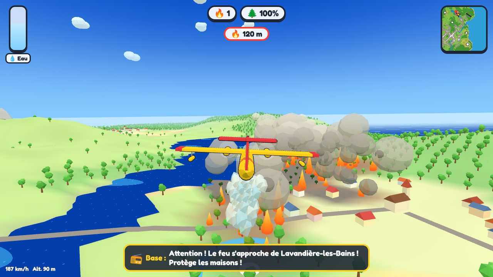
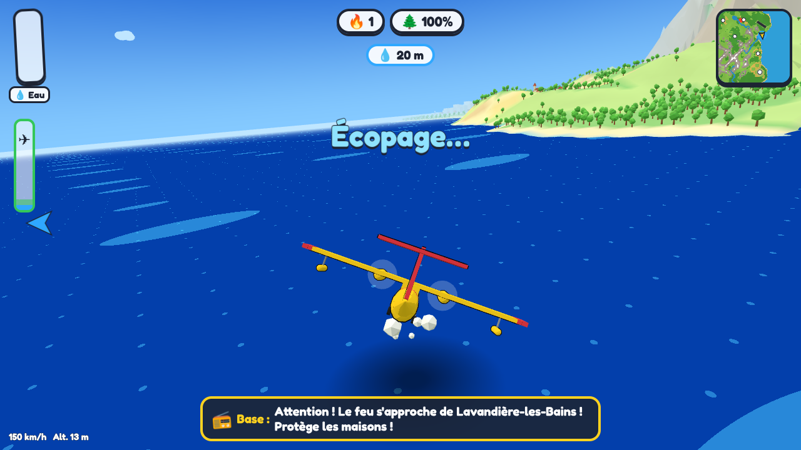
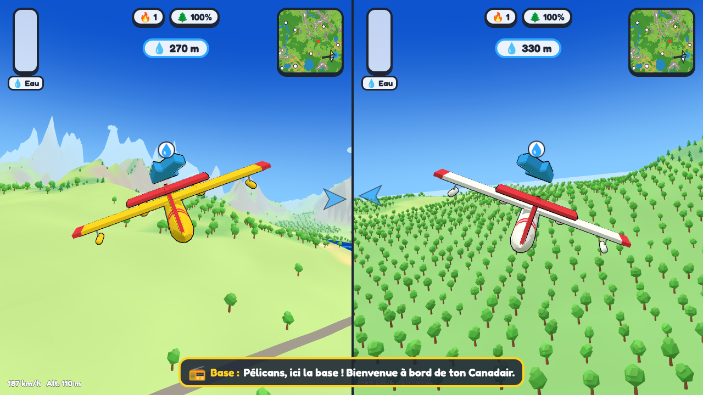

# Canadair – Les pompiers du ciel

Jeu vidéo pour enfants en **HTML, CSS et JavaScript** : pilote un Canadair, décolle de l'aérodrome, écope de l'eau dans les lacs, les fleuves ou la mer, puis largue-la sur les feux de forêt annoncés à la radio. Style cartoon, carte différente à chaque partie.



| Écopage en mer | Écran partagé à deux manettes |
|---|---|
|  |  |

## Jouer

- **En ligne** (recommandé) : <https://hjoudrier.github.io/canadair/> une fois GitHub Pages activé (voir plus bas). Le gyroscope du téléphone et la VR exigent une adresse **HTTPS**, ce que fournit GitHub Pages.
- **En local** : dans le dossier du projet, lance `python3 -m http.server 8080` puis ouvre <http://localhost:8080>. Aucune installation : Three.js est fourni dans `vendor/three/`.

### Modes de jeu

| Mode | Pour qui |
|---|---|
| **Jouer seul** | Téléphone (gyroscope + tactile), ordinateur (clavier) ou console (manette). |
| **À deux : écran partagé** | Deux manettes : chacun son Canadair, écran coupé en deux (gauche / droite). |
| **À deux : même avion** | Un seul avion, deux pilotes. Les commandes s'additionnent : un adulte peut corriger la trajectoire d'un tout-petit. En maintenant **LB**, le copilote prend complètement la main. |
| **Jouer en VR** | Casque Meta Quest 3 : assis dans le cockpit. Le bouton n'apparaît que si le navigateur gère la VR. |

### Deux niveaux

- **Petit pilote** : l'avion garde tout seul une bonne hauteur, ne s'écrase jamais, descend tout seul au ras de l'eau pour écoper, et l'eau larguée est « aimantée » vers les flammes proches.
- **Grand pilote** : on gère les gaz, l'altitude et la durée du largage ; toucher le sol renvoie à la piste.

### Déroulement

1. **Décoller** : mets les gaz sur la piste.
2. **Écoper** : suis la **flèche bleue**, vole au ras de l'eau (la jauge d'altitude devient verte) jusqu'à remplir le réservoir.
3. **Éteindre** : suis la **flèche rouge**, le cercle bleu au sol montre où tombera l'eau, puis largue au-dessus des flammes. Mouiller la forêt devant le feu limite sa propagation.
4. La radio annonce les nouveaux départs de feu, le vent et les villages menacés. Quand tout est éteint, la **flèche verte** ramène à la base : se poser rapporte une étoile bonus.

La mini-carte (en haut à droite) montre les feux, les villages, l'aérodrome et les avions. Les flèches peuvent être désactivées dans les réglages. Les cartes sont générées au hasard : montagnes, collines, plaines, forêts, villages, villes, fleuves, lacs et mer (côte, île ou pays des lacs). Le numéro de carte est affiché dans les réglages pour rejouer la même.

## Commandes

| Action | Manette (Xbox…) | Clavier | Téléphone | Quest 3 |
|---|---|---|---|---|
| Tourner | stick gauche | ← → ou Q D (A D) | tourner le téléphone comme un volant | stick droit |
| Monter / descendre | stick gauche haut / bas | ↑ ↓ ou Z S (W S) | incliner le haut du téléphone vers soi / loin de soi | stick droit |
| Gaz (Grand pilote) | RT / LT | Maj / Ctrl | curseur ⚡ à gauche | stick gauche |
| Décoller | A | Entrée | bouton « Décoller ! » | gâchette |
| Larguer l'eau | A ou RB | Espace | bouton 💧 | gâchette |
| Caméra (derrière / cockpit) | B ou Y | C | 🎥 | A |
| Pause | Menu (Start) | Échap ou P | ⏸ | Y |
| Copilote prend la main | LB (2ᵉ manette) | G | – | – |
| Recentrer la vue VR | – | – | – | X |

- Les menus se pilotent entièrement à la manette (croix ou stick, A pour valider, B pour revenir) : pas besoin de souris sur Xbox.
- Sur téléphone, le jeu passe en plein écran paysage. Sur iPhone, accepte l'accès aux mouvements quand il est demandé. Sans gyroscope, un joystick tactile s'affiche (activable aussi dans les réglages). « Recalibrer le téléphone » est dans le menu pause.
- Les manettes vibrent à l'écopage, au largage et en cas de choc.

## Mise en ligne sur GitHub Pages

Le workflow `.github/workflows/pages.yml` lance les tests à chaque push et publie le jeu depuis la branche `main`. À faire une seule fois : **Settings → Pages → Build and deployment → Source : GitHub Actions**. Pour un dépôt privé, GitHub Pages demande un forfait payant ; sinon, rends le dépôt public.

## Développement

```
index.html, css/, assets/        page, style cartoon, icône
vendor/three/                    Three.js r170 (licence MIT)
src/main.js                      menus, appareils, lancement des parties
src/world/                       génération procédurale (relief, eau, lieux) et maillages
src/fire/                        simulation du feu (automate cellulaire) et affichage
src/plane/                       modèle de vol, largage, Canadair 3D, effets d'eau
src/game/                        boucle de jeu, mission, choix des cibles des flèches
src/input/                       clavier, manettes, coop, tactile, gyroscope, WebXR
src/ui/ src/audio/ src/i18n/     tableau de bord, radio, sons synthétisés, français / anglais
tests/                           tests unitaires et test de bout en bout
```

- Tests unitaires (Node 22, aucune dépendance) : `npm test`
- Test de bout en bout avec captures (Playwright + Chromium) : `npm run e2e`
- Lancement direct pour déboguer : `index.html?auto=1&mode=solo&diff=easy&seed=42` (`mode` = `solo`, `split`, `shared` ; `diff` = `easy`, `hard`).

Tous les sons sont synthétisés (WebAudio) et la voix de la radio utilise la synthèse vocale du navigateur ; les sous-titres s'affichent toujours.

## Licence

GPL v3 (voir `LICENSE`). Three.js est sous licence MIT (`vendor/three/LICENSE`).

---

## English

**Canadair – Sky Firefighters** is a cartoon water-bomber game for kids, written in plain HTML/CSS/JavaScript with Three.js. Take off, scoop water from lakes, rivers or the sea, and drop it on forest fires announced over the radio. Every map is procedurally generated.

- Play solo on a phone (tilt + touch), a computer (keyboard) or a console (gamepad); two players on split screen, or two players flying the **same plane** (a grown-up can help a young child; hold LB to take over); or in VR on a Meta Quest 3.
- Two levels: *Little pilot* (heavily assisted, never crashes) and *Big pilot* (manual throttle, altitude and drop).
- Blue arrow = water, red arrow = fire, green arrow = base. Language (French / English) is chosen automatically and can be changed in the settings.
- Run locally with `python3 -m http.server 8080`, or enable GitHub Pages (Settings → Pages → Source: GitHub Actions) for HTTPS, which tilt controls and VR require.
